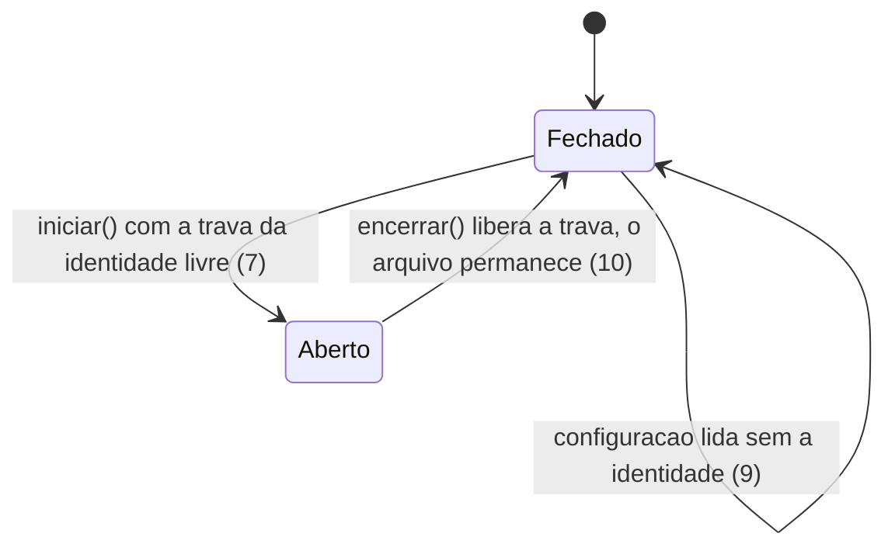

# Fronteira de reuso do componente

> Build this with **tlc-implement**.
> Every criterion below becomes a check with a proof, referenced by its number. Nothing under
> `Unresolved` gets settled while building.

## Intent

Hoje o componente anuncia **57 tipos publicos**, incluindo os 6 estados concretos, os 8 handlers
de notificacao e o `PainelPedidoPresenter` de 7 argumentos. Quem consome nao consegue distinguir o
que e API do que e interno, entao toda refatoracao interna vira quebra de contrato; e embutir o
painel exige remontar a composicao a mao - Presenter de 7 argumentos, 7 handlers, 2 servicos e 2
observers - porque `PainelPedidoFacade.iniciar()` sempre cria a janela. Quem paga e o consumidor
seguinte, e o custo cresce: com zero consumidores a fronteira e so apagar `public`; depois do
primeiro, cada tipo publico e contrato. A instancia unica e fixa em
`${java.io.tmpdir}/painel_pedidos.lock` (`PainelPedidoFacade:177`), entao dois sistemas diferentes
na mesma maquina recusam um ao outro - cenario confirmado como real.

A fronteira passa a ser um contrato enumerado, com o resto marcado como interno, e o painel ganha um
caminho de embutir que reusa a composicao da fachada. A instancia unica passa a ser por aplicacao,
com identidade vinda da configuracao. A dependencia embutida e relocada para conviver com a dotenv
do consumidor.

12 criterios em 4 slices · 6 portas de mao unica · 0 abertas.

## Criteria

### Contrato

1. Sempre, o conjunto de tipos publicos fora dos pacotes `internal` e exatamente: `PainelPedidoFacade`,
   `PedidoAbstract`, `IPedidoRepository`, `ConfiguracaoPainelPedido`, `LeitorConfiguracaoPainelPedido`,
   `IVisualizarPedidoListener`, `IConfirmarPagamentoListener`, `ICriarNovoPedidoListener`,
   `IEstrategiaSom`, `SomTomStrategy`, `IRelogioService`, `RelogioServiceSistema`,
   `IPainelPedidoView`, `PainelPedidoView`.
2. Quando um tipo publico e acrescentado ou retirado fora de `internal`, o build falha e a mensagem
   nomeia o tipo.
3. Sempre, todo tipo que nao pertence ao contrato reside sob um pacote `internal`.

### Embutir

4. Quando um consumidor pede o painel a fachada para embutir, entao recebe a `PainelPedidoView`
   montada e nenhuma janela e criada.
5. Quando o consumidor executa a fachada, entao a janela e criada maximizada.
6. Sempre, embutir nao exige importar nenhum tipo de `internal` - o modulo de exemplo embute sem
   citar `presenter`.

### Identidade da aplicacao

7. Dado o sistema A com o painel aberto, quando o sistema B abre com identidade diferente na mesma
   maquina, entao as duas aberturas sao concedidas.
8. Dado o sistema A com o painel aberto, quando o sistema A abre de novo, entao a segunda abertura
   devolve `false` e nada e aberto.
9. Se a identidade nao for informada na configuracao, entao uma excecao orientando informa-la e
   lancada.
10. Enquanto houver identidade configurada, o arquivo de controle deriva dela - nunca um nome fixo
    do componente.

### Empacotamento

11. Dado um consumidor com a dotenv no proprio classpath, quando ele usa o componente, entao nao ha
    conflito de classes.
12. Sempre, o jar gerado contem as dependencias e a copia embutida esta relocada - a classe
    `io.github.cdimascio.dotenv.Dotenv` nao aparece no caminho original.

## States

## Out of scope

- JPMS (`module-info`) - a dependencia nao e modular e o shade exclui `module-info.class`; a
  fronteira e sinalizada e vigiada, nao imposta pelo compilador.
- Publicacao no JitPack - a cargo do mantenedor.
- Redesenho de telas e persistencia - nao fazem parte desta fronteira.

## Observable

| Surface | Decision | Landing |
| --- | --- | --- |
| API `PainelPedidoFacade` | error shape and codes | existing - mensagens orientadoras (regra do AGENTS.md) |
| API `PainelPedidoFacade` | who may call it | n/a - componente desktop, sem controle de acesso |
| API `PainelPedidoFacade` | versioning | 1 - o contrato enumerado e o sinal de versao |
| API `PainelPedidoFacade` | rate limit | n/a - nao ha chamada remota |
| API `IPedidoRepository` | versioning | 1 - e contrato, implementado pelo consumidor |
| document `painel_pedidos.env` | structure and keys | 9 - a identidade entra como chave |
| document `painel_pedidos.env.example` | what the reader does next | existing - documenta as chaves do componente |
| document `README.md` / `painel-pedidos/README.md` | structure, tone, depth | 3 - o contrato passa a ser listado |
| collection `tipos publicos` | grouping criterion | 1 |
| collection `tipos publicos` | naming | 3 - `internal` |
| collection `tipos publicos` | ordering | n/a - o conjunto nao tem ordem |
| collection `tipos publicos` | duplicates | n/a - nao ha duplicidade possivel |
| collection `tipos publicos` | the exception that does not fit | n/a - todo tipo nao-contrato cabe sob `internal`; o que fica publico ali esta marcado (3) |
| screen `<painel>` | - | n/a - nenhuma tela nova ou alterada |

## Swept

- validation: 9
- failure modes: 2 - o gate nomeia o tipo que saiu do contrato; a recusa de abertura ja e sinalizada pelo retorno
- idempotency and retry: existing - `iniciar()` duas vezes: a segunda recusa (US25-001)
- authorization: n/a - componente desktop, sem controle de acesso
- concurrency and ordering: 7, 8
- data lifecycle: 10 - o arquivo permanece e nao bloqueia (a trava e do sistema operacional); um arquivo com o nome antigo fica inerte
- external-dependency failure: 11
- state transitions: n/a - o ciclo de vida do pedido (BR12/BR13) nao muda
- observability: existing - a recusa e sinalizada pelo retorno `boolean`; a mensagem ao usuario e do consumidor

## Impact

| Front | What changes |
|---|---|
| domain | new term: `identidade da aplicacao` - o que distingue um painel de outro na mesma maquina, lives in `configuracao` |
| domain | existing term: `PainelPedidoPresenter` passa a ser interno - hoje o teste do consumidor e o `exemplo` montam-no direto |
| domain | existing term: `iniciar()` deixa de ser a unica porta - passa a existir o caminho de embutir |
| stored data | nothing to migrate; o nome do arquivo de trava muda, e um arquivo remanescente com o nome antigo e inerte |

Disturbed: 3 pontos de construcao de `new ConfiguracaoPainelPedido`, 2 literais do nome do arquivo de
trava (fachada e teste da fachada, que mudam juntos), o `painel_pedidos.env` do exemplo e o
`painel_pedidos.env.example`, os dois READMEs, e os 2 testes que hoje montam `PainelPedidoPresenter`.

## Decided

| Decision | Shape | Alternative rejected |
|---|---|---|
| O contrato e enumerado; o resto vai para `internal` | pacotes `...internal.*`, publicos porem fora do contrato | deixar tudo publico - nenhum sinal de fronteira; package-private - impossivel, os usuarios moram em outro pacote |
| A fronteira nao e imposta pelo compilador | convencao `internal` + teste de allow-list | JPMS - a dependencia nao tem `module-info` e o shade o exclui, entao o jar gordo nao e modulo |
| A instancia unica e por aplicacao, com identidade obrigatoria | identidade obrigatoria na configuracao (`IDENTIFICADOR_APLICACAO`); arquivo de trava derivado dela | nome fixo do componente - dois sistemas na mesma maquina colidem; default pelo titulo da janela - dois sistemas com o mesmo titulo colidem em silencio |
| A fachada compoe e entrega o painel | um caminho de embutir que nao cria janela | consumidor remontar Presenter e servicos - duplica a composicao e obriga a importar internos |
| A dependencia embutida e relocada | `<relocations>` no shade para o pacote da dotenv | embutir sem relocar - conflito de classes no classpath do consumidor |
| O contrato e fixado por teste | allow-list explicita dos tipos publicos | revisao apenas - nao impede a fronteira de crescer em silencio |

## Surface

| Route | In | Out | Status | Criteria |
|---|---|---|---|---|
| `PainelPedidoFacade` - pedir o painel montado | - | `PainelPedidoView` | - | 4 |
| `PainelPedidoFacade#iniciar()` | - | `boolean` | `true` aberto, `false` recusado | 5, 7, 8 |
| `ConfiguracaoPainelPedido` - identidade | identidade da aplicacao | - | ausente lanca excecao | 9 |
| `painel_pedidos.env` - chave da identidade | valor da identidade | - | ausente lanca excecao | 9 |

## Sources

- `.design/fronteira-de-reuso.md` - **binding for the interface**: contrato enumerado, caminho de
  embutir, identidade da aplicacao e relocacao; achados com a origem no codigo.
- `openspec/AGENTS.md` - visibilidade minima, configuracao obrigatoria, regra de instancia unica e
  mensagens orientadoras.
- Decisao de assumir o default da identidade como obrigatoria: `user delegated` pelo autor do
  projeto nesta sessao.

This task is the record of decision. If a linked document diverges, ask before building.

## Unresolved

None - a unica questao aberta (identidade obrigatoria ou com default) foi decidida
pelo autor: obrigatoria.
