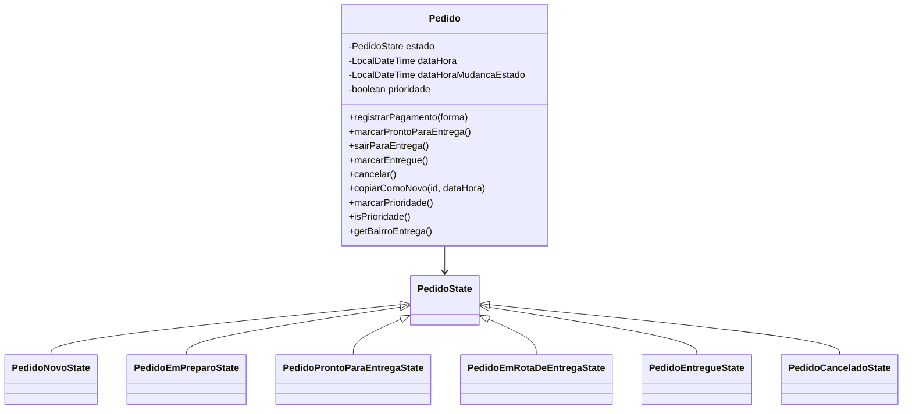
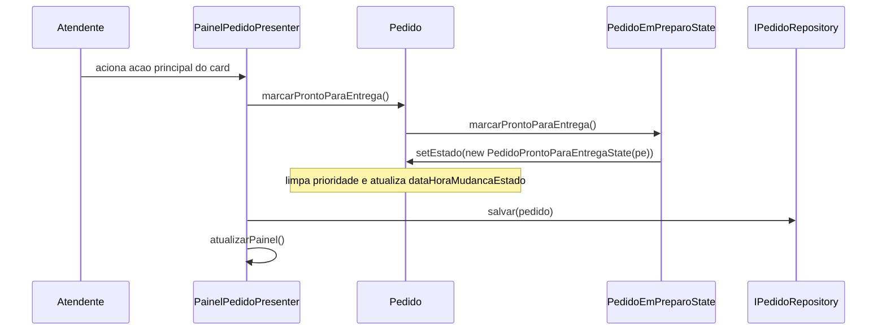
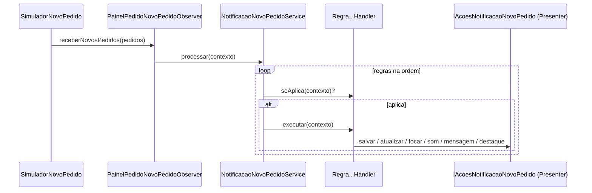
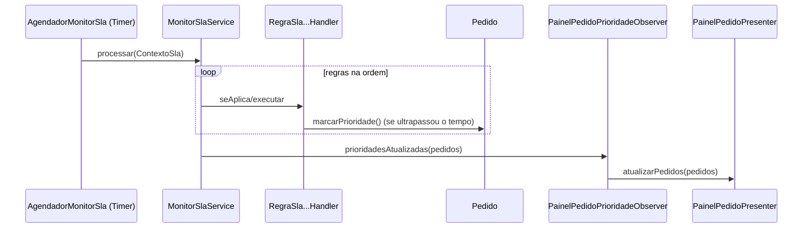
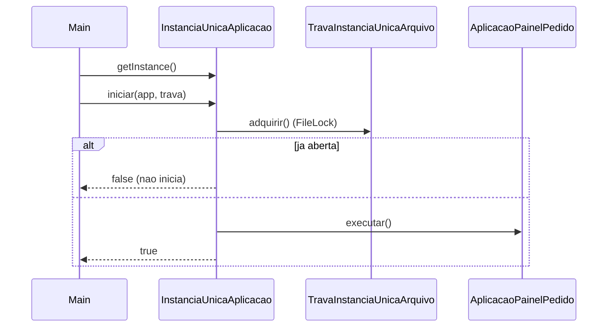

# Design - Painel de Acompanhamento de Pedidos

Documento tecnico derivado do codigo implementado (78 classes). Descreve a
arquitetura, os padroes, os fluxos e as decisoes.

## 1. Visao arquitetural

MVP (Model-View-Presenter) na variante **Passive View**:

- **Model**: `model.Pedido` (+ `Cliente`, `Item`, `CupomDescontoEntrega`,
  `CupomDescontoPedido`) e o ciclo de vida em `state`.
- **View**: `view.IPainelPedidoView` (abstracao) e `view.PainelPedidoView`
  (NetBeans). Passiva: nao configura listeners, nao tem `main`, nao tem setters
  publicos; expoe getters usados pela Presenter.
- **Presenter**: `presenter.PainelPedidoPresenter` coordena, le a View, aciona o
  Model/Repository e instrui a View.
- **Composicao**: `aplicacao.AplicacaoPainelPedido` (unico `main`) monta tudo.

## 2. Pacotes e responsabilidades

| Pacote | Responsabilidade |
|---|---|
| `aplicacao` | Composicao, `main`, instancia unica (Singleton + trava). |
| `configuracao` | `LeitorEnv` (Adapter do dotenv), `ConfiguracaoService`. |
| `dados` | `CatalogoPedido` (pools de nomes/enderecos/formas). |
| `filtro` | `IFiltroPeriodo` + filtros; `IFabricaFiltroPeriodo`. |
| `model` | `Pedido` e apoio de dominio. |
| `state` | GoF State do ciclo de vida. |
| `repositorio` | `IPedidoRepository` + `PedidoEmMemoriaRepository`. |
| `seeder` | `PedidoSeeder` deterministico. |
| `simulacao` | Simulador, gerador, tempo/aleatoriedade injetados; `simulacao.observer`. |
| `notificacao` | CoR adaptado da notificacao de novos pedidos (`RegraHandler`/`Service`). |
| `som` | Strategy de som (`IEstrategiaSom`). |
| `sla` | CoR adaptado do SLA (`RegraSlaHandler`/`MonitorSlaService`), agendador; `sla.observer`. |
| `tempo` | `ITempoEntregaService` (media por bairro). |
| `ordenacao` | `IOrdenacaoPedidos` (Strategy de ordenacao). |
| `presenter` | `PainelPedidoPresenter`. |
| `view` | `IPainelPedidoView` + `PainelPedidoView` (+ `.form`). |

## 3. Diagrama de classes (resumo)



## 4. Padroes aplicados

- Maquinas de estado UML de cada elemento com estados (GoF State e estados
  implicitos): [`state-machines.md`](./state-machines.md).

- **State** (`state`): `PedidoState` abstrata com `protected Pedido pedido`,
  operacoes default que lancam `RuntimeException`, e estados concretos
  `Pedido<...>State` que validam pre-condicoes no construtor e transicionam via
  `pedido.setEstado(new ProximoState(pedido))`.
- **Strategy**:
  - Filtro de periodo (`filtro`): `IFiltroPeriodo` + `IFabricaFiltroPeriodo`.
  - Som (`som`): `IEstrategiaSom` (`SomTomStrategy` / `SomToolkitStrategy`).
  - Ordenacao (`ordenacao`): `IOrdenacaoPedidos` (`OrdenacaoPorTempoNoEstado`).
  - Tempo/aleatoriedade (`simulacao`): `IRelogioService`, `IAleatoriedadeService`.
- **Chain of Responsibility adaptado** (`notificacao`, `sla`): uma abstracao
  `Regra...Handler` (`seAplica`/`executar`), concretas `...Handler` sem
  referencia entre si, e um `...Service` que mantem a colecao e `processar(...)`
  na ordem. Orquestradores: `NotificacaoNovoPedidoService`, `MonitorSlaService`.
- **Observer** (GoF): abstracao e concretas com sufixo `Observer`.
  - `simulacao.observer.NovoPedidoObserver` / `PainelPedidoNovoPedidoObserver`.
  - `sla.observer.PrioridadeObserver` / `PainelPedidoPrioridadeObserver`.
- **Adapter**: `configuracao.LeitorEnv` encapsula `io.github.cdimascio:dotenv-java`.
- **Singleton thread-safe**: `aplicacao.InstanciaUnicaAplicacao`
  (double-checked locking) + `ITravaInstanciaUnica` (`FileLock`).

## 5. Fluxos

### 5.1 Transicao de estado (ex.: Em preparo -> Pronto para entrega)



### 5.2 Notificacao de novos pedidos (CoR adaptado + Observer)



### 5.3 Monitor de SLA (CoR adaptado + Observer)



### 5.4 Abertura unica (Singleton + trava)



## 6. Contratos (abstracoes principais)

```java
interface IPedidoRepository { void salvar(Pedido p); List<Pedido> buscarTodos(); String gerarProximoIdentificador(); }
interface IPainelPedidoView { JFrame getJanelaPrincipal(); JComboBox<String> getCmbPeriodo(); JSpinner getSpnData(); JLabel getLblNotificacao(); ... }
interface IFiltroPeriodo { boolean aceita(LocalDateTime dataHora, LocalDate hoje); LocalDate getDataParaNovoPedido(); }
interface IFabricaFiltroPeriodo { IFiltroPeriodo criar(int indice, LocalDate data); boolean exigeData(int indice); }
interface IFonteDataPedido { void usarDataAtual(); void usarData(LocalDate d); LocalDateTime obterDataHora(); }
interface IGeradorPedido { Pedido gerar(); }
interface ISimuladorNovoPedido { void iniciar(NovoPedidoObserver o); void parar(); }
interface NovoPedidoObserver { void receberNovosPedidos(List<Pedido> p); }
interface RegraHandler { boolean seAplica(ContextoNotificacaoNovoPedido c); void executar(ContextoNotificacaoNovoPedido c); }
interface IServicoNotificacaoNovoPedido { void processar(ContextoNotificacaoNovoPedido c); }
interface IEstrategiaSom { void tocar(); }
interface IOrdenacaoPedidos extends Comparator<Pedido> {}
interface ITempoEntregaService { Duration tempoMedioEntrega(String bairro); void registrarEntrega(String bairro, Duration d); }
interface IRelogioService { LocalDateTime agora(); }
interface IAleatoriedadeService { int sortearInteiro(int origem, int limite); }
interface RegraSlaHandler { boolean seAplica(ContextoSla c); void executar(ContextoSla c); }
interface IMonitorSlaService { void adicionarObserver(PrioridadeObserver o); void processar(ContextoSla c); }
interface PrioridadeObserver { void prioridadesAtualizadas(List<Pedido> p); }
interface IPainelPedidoAtualizador { void atualizarPedidos(List<Pedido> p); }
interface IExecucaoAplicacao { void executar(); }
interface ITravaInstanciaUnica { boolean adquirir(); }
```

## 7. Configuracao (.env)

`SEED_QUANTIDADE`, `SIMULACAO_INTERVALO_MINIMO_SEGUNDOS`,
`SIMULACAO_INTERVALO_MAXIMO_SEGUNDOS`, `SIMULACAO_MENSAGEM_SEGUNDOS`,
`SIMULACAO_PEDIDOS_POR_CICLO`, `SLA_NOVO_MINUTOS`, `SLA_EM_PREPARO_MINUTOS`,
`SLA_ENTREGA_BAIRRO_MINUTOS`, `SLA_MONITOR_INTERVALO_SEGUNDOS`. Lido por
`LeitorEnv` (nenhuma outra classe conhece dotenv).

## 8. Decisoes de design

1. **DIP**: Presenter e servicos dependem de abstracoes injetadas na composicao;
   nada instancia implementacoes concretas fora de `aplicacao`.
2. **SRP**: filtros, ordenacao, SLA, notificacao, som e seed em classes
   dedicadas; a Presenter coordena.
3. **OCP**: novo filtro/som/ordenacao/estado/regra = nova classe; a composicao
   escolhe a ordem das regras no `Service`.
4. **Estado com logica no construtor**: transicao so ocorre se a pre-condicao do
   proximo estado for atendida.
5. **Sem estado estatico**, exceto o `private static volatile` do Singleton.
6. **Sem lambda/Stream/enum/instanceof/Runnable**; excecoes unchecked;
   `Objects.requireNonNull`.
7. **Persistencia em memoria** atras de `IPedidoRepository` (troca futura por
   banco custa uma implementacao).
8. **Ordenacao por tempo no estado** dentro de cada raia (`dataHoraMudancaEstado`
   ascendente); prioridade e por estado (limpa em `setEstado`).

## 9. Rastreabilidade de padroes

| Padrao | Pacote | Abstrato | Concretos | Orquestrador |
|---|---|---|---|---|
| State | `state` | `PedidoState` | `Pedido*State` | `Pedido` (contexto) |
| Strategy (filtro) | `filtro` | `IFiltroPeriodo` | `Filtro*` | `IFabricaFiltroPeriodo` |
| Strategy (som) | `som` | `IEstrategiaSom` | `SomTomStrategy`, `SomToolkitStrategy` | composicao |
| Strategy (ordenacao) | `ordenacao` | `IOrdenacaoPedidos` | `OrdenacaoPorTempoNoEstado` | composicao |
| CoR adaptado | `notificacao` | `RegraHandler` | `*Handler` | `NotificacaoNovoPedidoService` |
| CoR adaptado | `sla` | `RegraSlaHandler` | `RegraSla*Handler` | `MonitorSlaService` |
| Observer | `simulacao.observer` | `NovoPedidoObserver` | `PainelPedidoNovoPedidoObserver` | `SimuladorNovoPedido` |
| Observer | `sla.observer` | `PrioridadeObserver` | `PainelPedidoPrioridadeObserver` | `MonitorSlaService` |
| Adapter | `configuracao` | - | `LeitorEnv` (sobre dotenv) | composicao |
| Singleton | `aplicacao` | `ITravaInstanciaUnica` | `InstanciaUnicaAplicacao`, `TravaInstanciaUnicaArquivo` | `AplicacaoPainelPedido` |

## 10. Dados de exemplo (seed) e persistencia

Decisao registrada (change `2026-10-06-painel-pedidos-mvp`, design completo em
`changes/archive/2026-10-06-painel-pedidos-mvp/design.md`):

- **Seeder dedicado** (`seeder.PedidoSeeder`): recebe a quantidade e uma data de
  referencia e gera o dataset de forma **deterministica** (sem `Random` nem
  relogio do sistema), conduzindo as **transicoes do dominio** (nunca define a
  situacao por string) nas seis situacoes e com datas em meses/dias variados.
  Cerca de 5% dos pedidos Novo iniciam priorizados.
- **Repositorio so persiste** (`repositorio.PedidoEmMemoriaRepository`): recebe a
  lista pronta no construtor e nao cria pedidos; `gerarProximoIdentificador`
  deriva do maior numero.
- **Persistencia em memoria** atras de `IPedidoRepository` (DIP): trocar por um
  banco custa apenas uma nova implementacao. Alternativa **H2 (JDBC, sem Spring)**
  so vence se houver exigencia de banco real ou persistencia entre execucoes - o
  que nao e o caso deste POC.
- **Configuracao por `.env`** (`SEED_QUANTIDADE`, etc.), lida por
  `configuracao.LeitorEnv` (Adapter do dotenv, unica dependencia de runtime).
