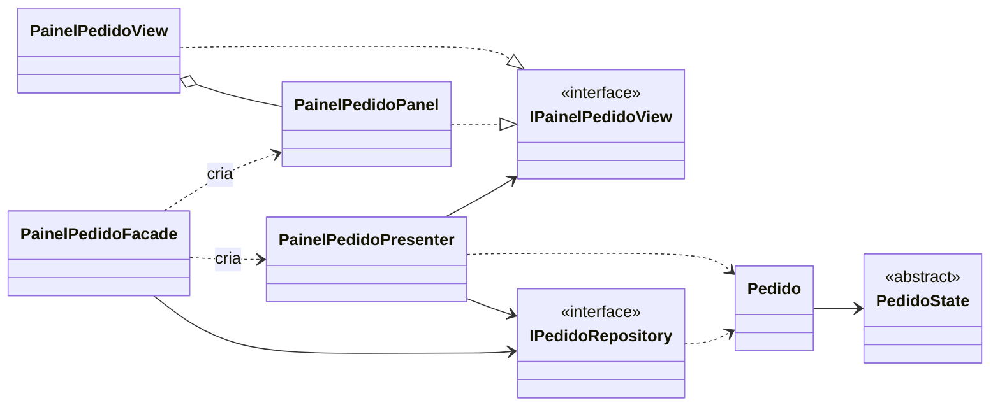
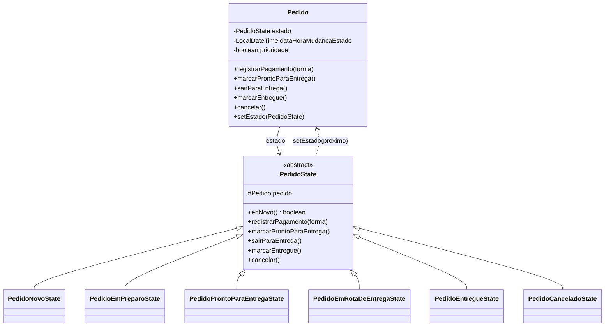
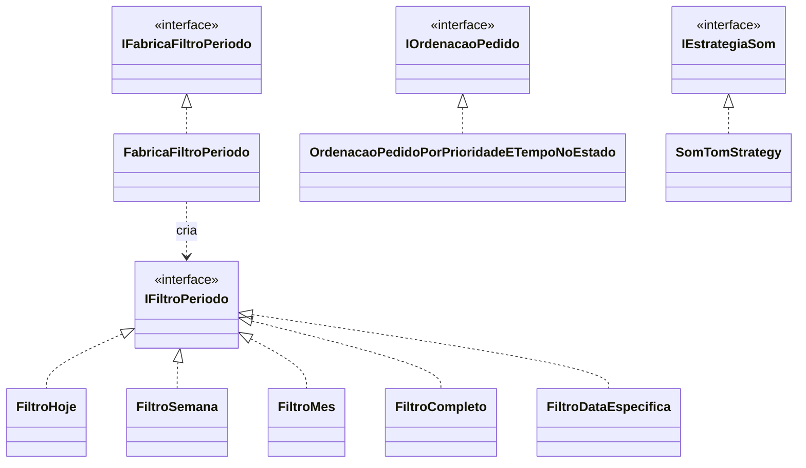
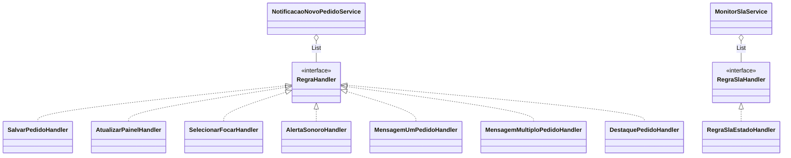
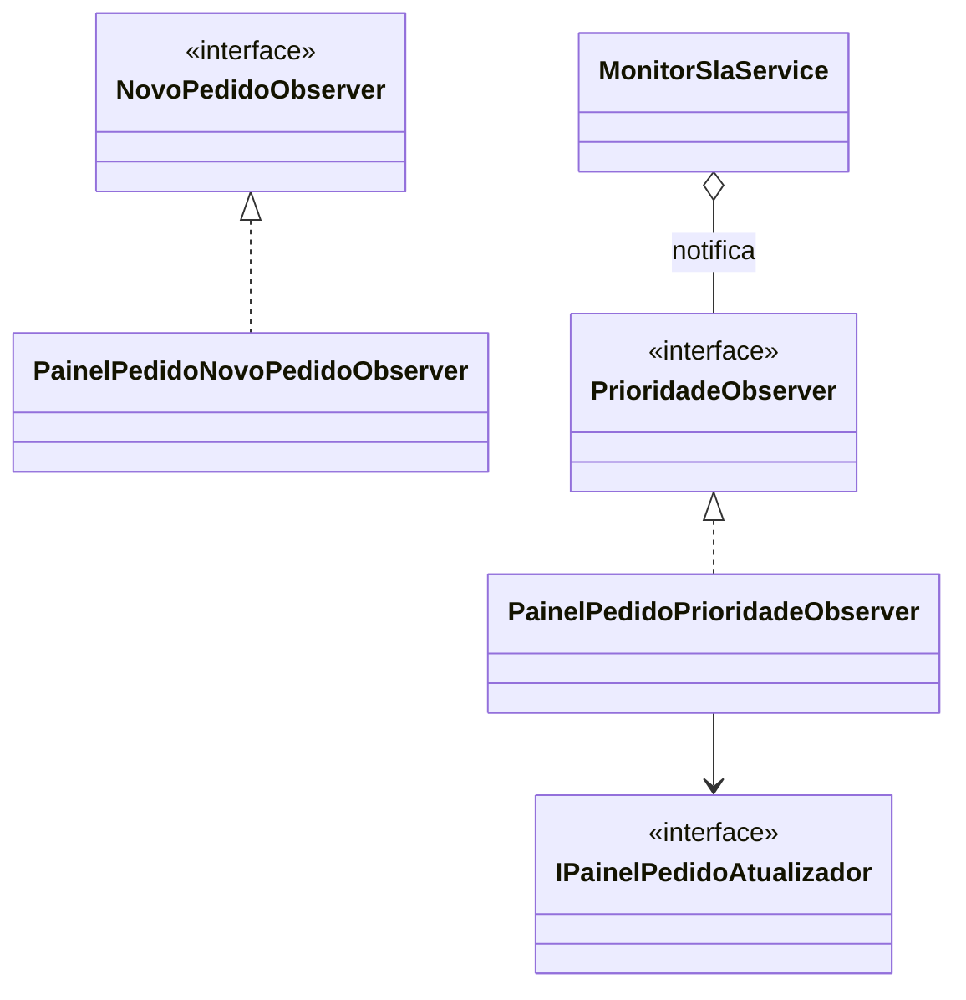
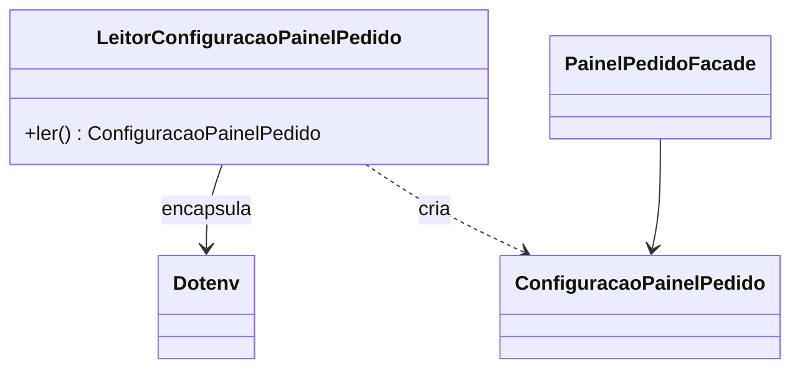
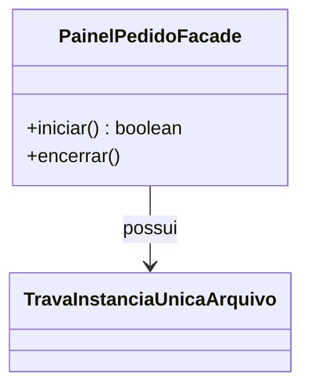

# Design - Painel de Acompanhamento de Pedidos (componente)

> Documento **tecnico** (como). Nao repete requisitos nem cenarios: eles vivem em
> [`spec.md`](./spec.md) e nos `.feature` desta pasta; a dinamica de estados esta
> em [`state-machines.md`](./state-machines.md). As decisoes da mudanca entregue
> estao em
> [`changes/archive/2026-10-11-componente-reutilizavel/design.md`](../../changes/archive/2026-10-11-componente-reutilizavel/design.md).

## 1. Introducao e visao arquitetural

O componente adota **MVP na variante Passive View** (POTEL, 1996; FOWLER, 2006):
a View apenas captura entrada e projeta saida, a Presenter coordena o fluxo e o
Model concentra dados e regras. A fachada `PainelPedidoFacade` compoe as dependencias
e executa o painel; o sistema consumidor fornece um `IPedidoRepository` e
empurra os novos pedidos via `receberNovosPedidos(...)`. A Figura 1 apresenta a
estrutura.

**Figura 1 - Estrutura MVP Passive View, portas e composicao.**

A Presenter depende das abstracoes `IPainelPedidoView` e `IPedidoRepository`; a
criacao concreta fica em `PainelPedidoFacade`. A View e materializada por
`PainelPedidoPanel` (um `JPanel` embedavel) e, opcionalmente, hospedada por
`PainelPedidoView` (um `JFrame` invólucro): assim o painel pode ser embutido em
outra aplicacao e renderizado sem janela. A alternativa MVC, com a View
observando o Model, foi preterida por ampliar o acoplamento (KRASNER; POPE,
1988).

## 2. GoF State (ciclo de vida do Pedido)

O ciclo de vida (BR12) usa **State** (GAMMA et al., 2000): o contexto `Pedido`
delega ao estado corrente e cada estado concentra as regras daquela situacao.

**Figura 2 - GoF State aplicado ao `Pedido`.**

Cada estado valida pre-condicoes no construtor: a transicao so ocorre quando o
estado alvo e valido. A alternativa `enum`+`switch` concentraria as regras em um
ponto e violaria abertura/fechamento (MARTIN, 2003).

## 3. Strategy (filtro de periodo, ordenacao, som)

Variacoes de algoritmo usam **Strategy** (GAMMA et al., 2000), conforme a
Figura 3. A Presenter depende sempre da abstracao.

**Figura 3 - Strategies de periodo, ordenacao e som.**

A ordenacao segue a regra de fila (FIFO): prioridade primeiro e, dentro da raia,
quem esta ha mais tempo no estado (`@US24-007`).

## 4. Chain of Responsibility adaptado (notificacao e SLA)

Regras independentes atuam sobre um mesmo contexto; nao ha referencia entre
tratadores e um `Service` mantem a colecao e a ordem (Figura 4), o que difere do
CoR classico com sucessor e parada no primeiro que trata (GAMMA et al., 2000).

**Figura 4 - Chain of Responsibility adaptado (Handlers + Service).**

## 5. Observer (novos pedidos e prioridade)

A ingestao de novos pedidos usa **Observer** (GAMMA et al., 2000): o **consumidor
e o sujeito** (a fonte do evento) e **empurra** os pedidos via
`receberNovosPedidos(...)`; o componente e o **observador** (`NovoPedidoObserver`
→ `PainelPedidoNovoPedidoObserver`), que dispara a cadeia de notificacao. A
prioridade do SLA tambem notifica via Observer.

**Figura 5 - Observer de novos pedidos (empurrao) e de prioridade.**

Este e o ponto que **substitui a simulacao**: em vez de o componente gerar ou ler
pedidos, o consumidor os empurra. Nao ha aleatoriedade, dado gerado nem leitura
automatica.

## 6. Adapter (configuracao por `painel_pedidos.env`)

O acesso ao arquivo e isolado por um **Adapter** (GAMMA et al., 2000):
`LeitorConfiguracaoPainelPedido` encapsula a biblioteca `dotenv-java` e produz
um `ConfiguracaoPainelPedido`.

**Figura 6 - Adapter sobre a biblioteca dotenv.**

Apenas o leitor conhece `Dotenv`; o restante depende de
`ConfiguracaoPainelPedido`. E a inversao de dependencia e a Lei de Demeter
(MARTIN, 2003).

## 7. Instancia unica do painel (trava de arquivo)

A abertura unica e **possuida pelo componente**: a fachada adquire uma trava de
arquivo ao iniciar e a libera ao encerrar (Figura 7). Nao ha mais Singleton - o
Singleton de JVM nunca resetava e impedia reabrir o painel no mesmo processo.

**Figura 7 - A fachada possui a trava de instancia unica.**

`PainelPedidoFacade.iniciar()` adquire a trava antes de criar a janela e devolve
`false` quando ela ja esta tomada (sem abrir janela, SLA ou observer);
`encerrar()` libera. A trava e detalhe interno (package-private): nao e porta nem
ponto de extensao. O componente nao possui nenhum campo `static`.

## 8. Empacotamento e distribuicao

- Multi-modulo Maven: `painel-pedidos-parent` (agregador), `painel-pedidos`
  (biblioteca) e `exemplo` (consumidor).
- O jar de `painel-pedidos` e produzido com `maven-shade-plugin` e contem as
  dependencias (dotenv incluso), para consumo como dependencia unica (JitPack).
- Java 21 (`--release 21`, bytecode Java 21); o `maven-enforcer-plugin` exige
  JDK `[21,)`, permitindo rodar o Maven em JDK mais novo (ex.: 24).

## 9. Restricoes transversais

As restricoes de linguagem e estilo (sem lambda, Stream, `enum`, `instanceof`,
`Runnable`, `BigDecimal`, `Optional`; sem atributos estaticos; excecoes
unchecked; nomenclatura) estao em [`AGENTS.md`](../../AGENTS.md)
e nao sao repetidas aqui.

## Referencias

ASSOCIACAO BRASILEIRA DE NORMAS TECNICAS. **NBR 6023**. Rio de Janeiro: ABNT, 2018.

FOWLER, M. **GUI architectures**. 2006. Disponivel em:
https://martinfowler.com/eaaDev/uiArchs.html.

GAMMA, E.; HELM, R.; JOHNSON, R.; VLISSIDES, J. **Padroes de projeto**. Porto
Alegre: Bookman, 2000.

KRASNER, G. E.; POPE, S. T. A description of the Model-View-Controller user
interface paradigm in the Smalltalk-80 system. **JOOP**, v. 1, n. 3, p. 26-49,
1988.

MARTIN, R. C. **Agile software development**. Upper Saddle River: Prentice Hall,
2003.

POTEL, M. **MVP: Model-View-Presenter**. Taligent Inc., 1996.
