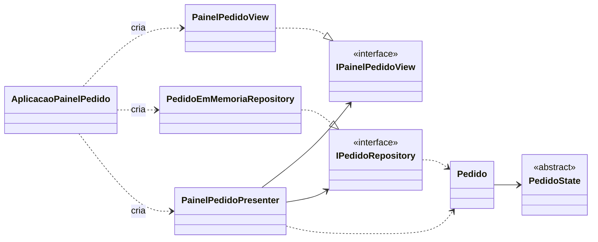
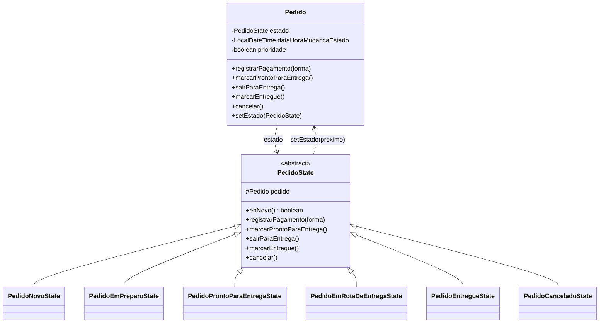
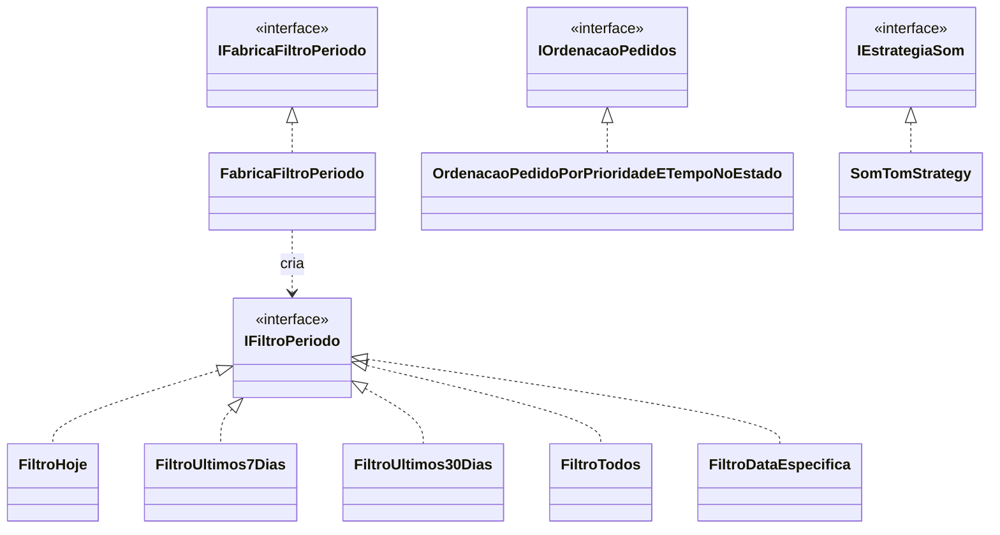
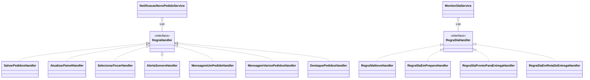
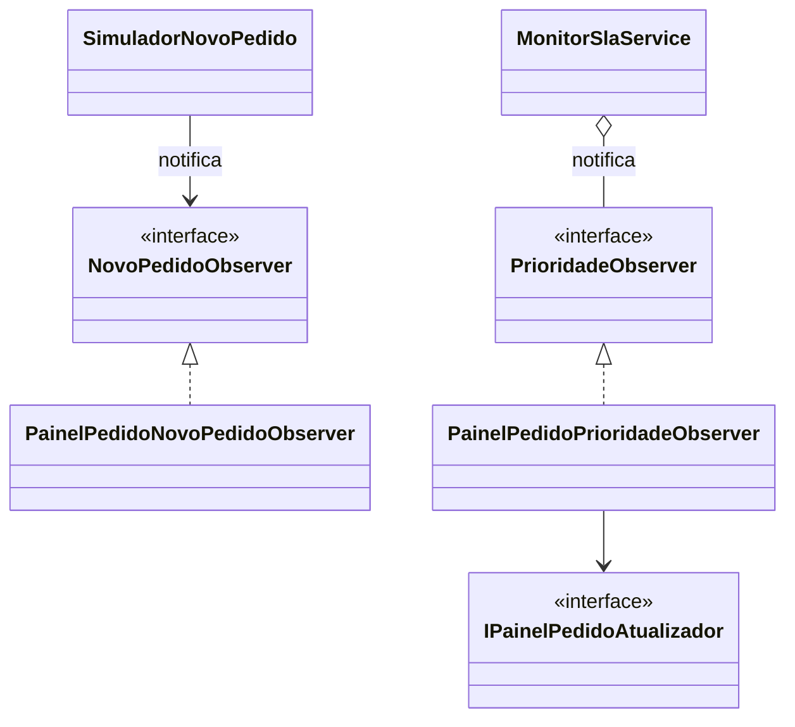
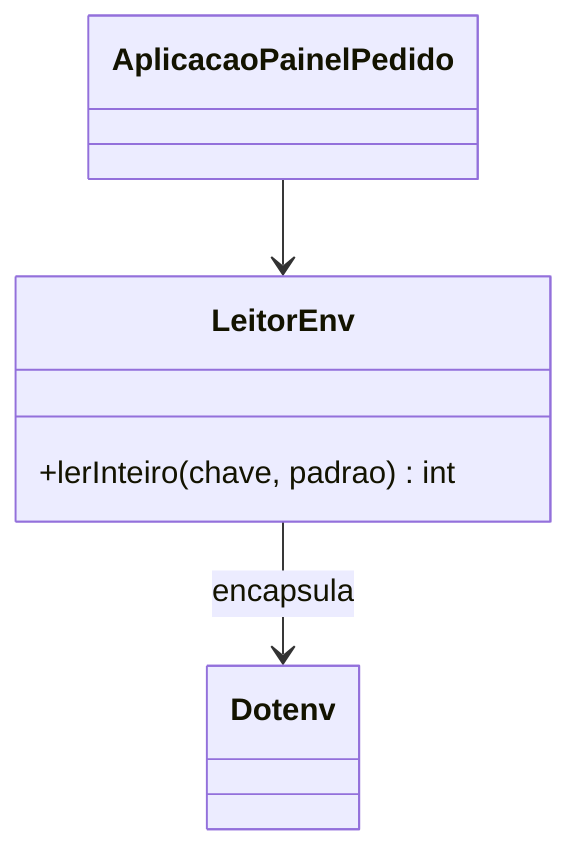
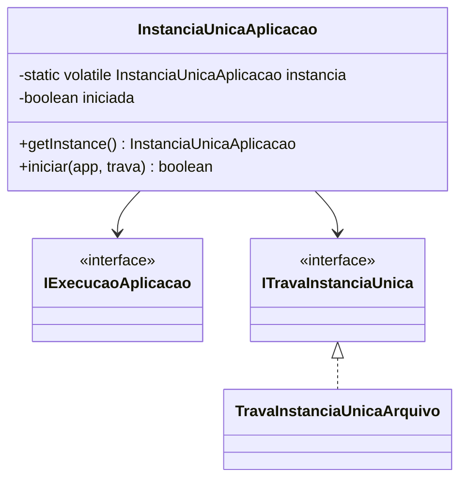

# Design - Painel de Acompanhamento de Pedidos

> Documento **tecnico** (como). Nao repete requisitos nem cenarios: eles vivem em
> [`spec.md`](./spec.md) e nos `.feature` desta pasta; a dinamica de estados esta
> em [`state-machines.md`](./state-machines.md). As decisoes da mudanca entregue
> estao em
> [`changes/archive/2026-10-06-painel-pedidos-mvp/design.md`](../../changes/archive/2026-10-06-painel-pedidos-mvp/design.md).

## 1. Introducao e visao arquitetural

O sistema adota o modelo **MVP na variante Passive View**, no qual a View apenas
captura entrada e projeta saida, a Presenter coordena o fluxo e o Model concentra
dados e regras (POTEL, 1996; FOWLER, 2006). Essa escolha separa a logica de
apresentacao da interface grafica e torna o comportamento verificavel sem a tela,
como recomendam Fowler (2006) e Martin (2003). A Figura 1 apresenta a estrutura
geral, com as camadas do MVP e o ponto de composicao.

**Figura 1 - Estrutura MVP Passive View e composicao.**

Como mostra a Figura 1, a Presenter depende das abstracoes `IPainelPedidoView` e
`IPedidoRepository`, e nao das implementacoes concretas; a criacao concreta fica
concentrada em `AplicacaoPainelPedido`, o unico `main`. Essa inversao de
dependencia (MARTIN, 2003) reduz o acoplamento e permite substituir a View ou o
repositorio sem alterar a regra de apresentacao. A alternativa MVC, na qual a
View observa diretamente o Model (KRASNER; POPE, 1988), foi preterida justamente
por ampliar o acoplamento entre interface e dominio.

## 2. GoF State (ciclo de vida do Pedido)

O ciclo de vida do `Pedido` (BR12, em [`spec.md`](./spec.md)) e modelado com
**State** (GAMMA et al., 2000): o contexto `Pedido` delega as operacoes ao estado
corrente, e cada estado concreto concentra as regras daquela situacao. A Figura 2
apresenta a estrutura de classes do padrao.

**Figura 2 - GoF State aplicado ao `Pedido`.**

A Figura 2 mostra que os estados sao substituiveis entre si (`PedidoState`),
atendendo ao principio de substituicao de Liskov, e que o `Pedido` depende apenas
da abstracao. As transicoes e a maquina de estados correspondente estao em
[`state-machines.md`](./state-machines.md) (secao 1). Adotar State aqui e a melhor
solucao porque o conjunto de situacoes e fechado, mas evolui, e as regras mudam
por situacao; a alternativa comum, um `enum` com `switch`, concentraria todas as
regras em um unico ponto, violando abertura/fechamento e responsabilidade unica
(MARTIN, 2003). Cada estado valida suas pre-condicoes no construtor, de modo que a
transicao so ocorre quando o estado alvo e valido, evitando objetos em estados
inconsistentes.

## 3. Strategy (filtro de periodo, ordenacao, som e tempo)

Variacoes de algoritmo sao encapsuladas com **Strategy** (GAMMA et al., 2000),
como mostra a Figura 3: filtro de periodo, ordenacao e som. A dependencia da
Presenter e sempre da abstracao, o que permite trocar a implementacao sem alterar
o cliente (MARTIN, 2003).

**Figura 3 - Strategies de periodo, ordenacao e som.**

Como ilustra a Figura 3, cada variacao de filtro e uma classe propria e a
`FabricaFiltroPeriodo` isola a criacao, mantendo a Presenter alheia aos tipos
concretos. A ordenacao segue a regra de **fila (FIFO)**: a
`OrdenacaoPedidoPorPrioridadeETempoNoEstado` coloca a prioridade primeiro e, em
seguida, quem esta ha mais tempo no estado (o pedido que chegou primeiro), de modo
que o atendimento respeite a ordem de chegada dentro de cada raia; detalhes do
comportamento observavel em `@US24-007`. Strategy e a melhor opcao aqui porque a
variedade de algoritmos e substituivel em tempo de execucao; a alternativa por
heranca exigiria subclasses rígidas e a alternativa por condicionais espalharia a
selecao pelo codigo (GAMMA et al., 2000).

## 4. Chain of Responsibility adaptado (notificacao e SLA)

Ao receber pedidos novos, uma sequencia de regras independentes atua sobre um
mesmo contexto. O GoF Chain of Responsibility classico encadeia tratadores por um
sucessor e, tipicamente, interrompe no primeiro que trata (GAMMA et al., 2000;
BUSCHMANN et al., 1996). Aqui, porem, as regras sao independentes, mais de uma
pode se aplicar e a ordem e uma decisao de composicao, o que motivou a variacao
adotada: nao ha referencia entre tratadores e um `Service` mantem a colecao e
dispara as regras aplicaveis. A Figura 4 apresenta essa estrutura.

**Figura 4 - Chain of Responsibility adaptado (Handlers + Service).**

A Figura 4 evidencia que nenhum `...Handler` conhece outro; `seAplica` decide a
aplicabilidade e o `Service` mantem a colecao e a ordem. O comportamento
observavel esta nos cenarios `@US23-*` (notificacao) e `@US24-*` (SLA). Para este
caso, a variacao e superior ao formato classico: elimina o acoplamento estrutural
entre tratadores, permite que varios atuem sobre a mesma requisicao e deixa a
composicao e a ordem visiveis em um unico ponto. Se o requisito fosse "passar a
requisicao adiante ate alguem tratar", o formato classico seria o adequado; como
nao e, adota-se a variacao.

## 5. Observer (atualizacoes de tela)

As atualizacoes de tela decorrentes de eventos usam **Observer** (GAMMA et al.,
2000): o sujeito notifica observadores registrados, que disparam a atualizacao,
sem que o produtor do evento conheca a interface. A Figura 5 apresenta os dois
usos.

**Figura 5 - Observer de novos pedidos e de prioridade.**

A Figura 5 mostra que `SimuladorNovoPedido` e `MonitorSlaService` notificam
observadores sem conhecer a tela; o `PainelPedidoPrioridadeObserver` adapta a
notificacao para o port `IPainelPedidoAtualizador`, implementado pela Presenter.
Esse desenho reduz o acoplamento entre produtores de evento e interface; a
alternativa, chamadas diretas a tela, acoplaria o simulador e o monitor a
Swing. O custo do padrao e a indirecao e a necessidade de gerenciar o ciclo de
vida dos observadores (GAMMA et al., 2000); aqui o tempo de vida coincide com o
da aplicacao, o que torna o custo aceitavel.

## 6. Adapter (configuracao por `.env`)

O acesso ao arquivo `.env` e isolado por um **Adapter** (GAMMA et al., 2000):
`LeitorEnv` encapsula a biblioteca `dotenv-java`, como mostra a Figura 6.

**Figura 6 - Adapter `LeitorEnv` sobre a biblioteca dotenv.**

Como mostra a Figura 6, apenas `LeitorEnv` conhece `Dotenv`; o restante do codigo
depende de `LeitorEnv`. Essa e a melhor solucao porque cumpre a inversao de
dependencia e a Lei de Demeter, evitando que detalhes de uma biblioteca de
terceiros se espalhem pelo sistema (MARTIN, 2003). A alternativa, ler o arquivo
diretamente em cada ponto de uso, criaria dependencia multipla e dispersaria a
tratativa de erros.

## 7. Singleton (instancia unica da aplicacao)

A abertura unica da aplicacao usa um **Singleton** thread-safe (GAMMA et al.,
2000) combinado com uma trava de arquivo, conforme a Figura 7.

**Figura 7 - Singleton de instancia unica com trava de arquivo.**

A Figura 7 mostra o ponto de criacao unica (`getInstance`) e a colaboracao com a
trava. O comportamento observavel esta em `@US25-001` e a maquina de estados em
[`state-machines.md`](./state-machines.md) (secoes 4 e 5).

Este e o unico ponto em que o uso do padrao merece ressalva. Embora o Singleton
garanta a unicidade na JVM, ele introduz um ponto de acesso global e dificulta a
testabilidade, o que a literatura aponta como sua principal fraqueza (MARTIN,
2003). Alem disso, a unicidade **entre processos** nao vem do Singleton, e sim da
trava de arquivo (`ITravaInstanciaUnica`). A proposta, portanto, e manter o
Singleton apenas como ponto de execucao unica (sem estado mutavel compartilhado
alem do proprio bootstrap) e tratá-lo como conveniencia sobre a trava, que e o
mecanismo real de instancia unica. Uma alternativa mais alinhada ao principio da
inversao de dependencia seria injetar um objeto de ciclo de vida criado no ponto
de entrada, evitando o acesso estatico; isso nao foi adotado porque o requisito e
exatamente "uma unica instancia", e o custo da inversao adicional nao se
justificou neste POC.

## 8. Configuracao (`.env`)

As chaves de configuracao e seus defaults estao em [`AGENTS.md`](../../AGENTS.md)
e no `.env.example`; sao lidas por `LeitorEnv` (secao 6). Este documento nao as
reproduz para evitar repeticao conceitual.

## 9. Restricoes transversais

As restricoes de linguagem e estilo (sem lambda, Stream, `enum`, `instanceof`,
`Runnable`, `BigDecimal`, `Optional`; sem atributos estaticos exceto o Singleton;
excecoes unchecked; nomenclatura) estao em [`AGENTS.md`](../../AGENTS.md) e nao
sao repetidas aqui. O design as respeita integralmente.

## Referencias

ASSOCIACAO BRASILEIRA DE NORMAS TECNICAS. **NBR 6023**: informacao e
documentacao: referencias: elaboracao. Rio de Janeiro: ABNT, 2018.

ASSOCIACAO BRASILEIRA DE NORMAS TECNICAS. **NBR 10520**: informacao e
documentacao: citacoes em documentos: apresentacao. Rio de Janeiro: ABNT, 2023.

BUSCHMANN, F.; MEUNIER, R.; ROHNERT, H.; SOMMERLAD, P.; STAL, M.
**Pattern-oriented software architecture**: a system of patterns. Chichester:
John Wiley & Sons, 1996. v. 1.

FOWLER, M. **GUI architectures**. 2006. Disponivel em:
https://martinfowler.com/eaaDev/uiArchs.html. Acesso em: 7 out. 2026.

FREEMAN, E.; ROBSON, E. **Use a cabeca! padroes de projeto**. 2. ed. Rio de
Janeiro: Alta Books, 2020.

GAMMA, E.; HELM, R.; JOHNSON, R.; VLISSIDES, J. **Padroes de projeto**: solucoes
reutilizaveis de software orientado a objetos. Porto Alegre: Bookman, 2000.

KRASNER, G. E.; POPE, S. T. A description of the Model-View-Controller user
interface paradigm in the Smalltalk-80 system. **Journal of Object-Oriented
Programming**, [S. l.], v. 1, n. 3, p. 26-49, 1988.

LARMAN, C. **Applying UML and patterns**: an introduction to object-oriented
analysis and design and iterative development. 3. ed. Upper Saddle River:
Prentice Hall, 2005.

MARTIN, R. C. **Agile software development**: principles, patterns, and
practices. Upper Saddle River: Prentice Hall, 2003.

POTEL, M. **MVP: Model-View-Presenter**: the Taligent programming model for C++
and Java. [S. l.]: Taligent Inc., 1996.
