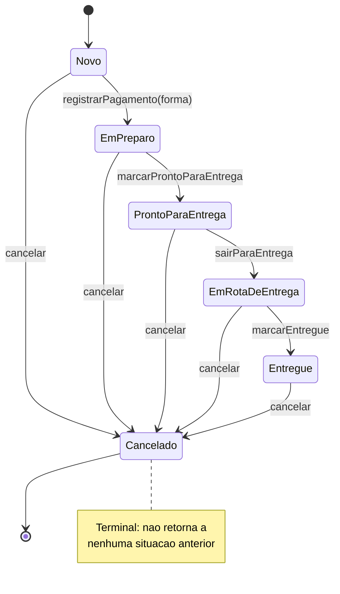
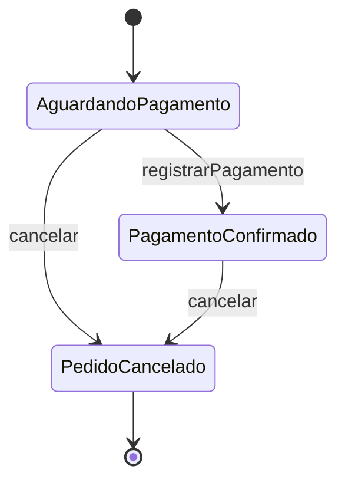
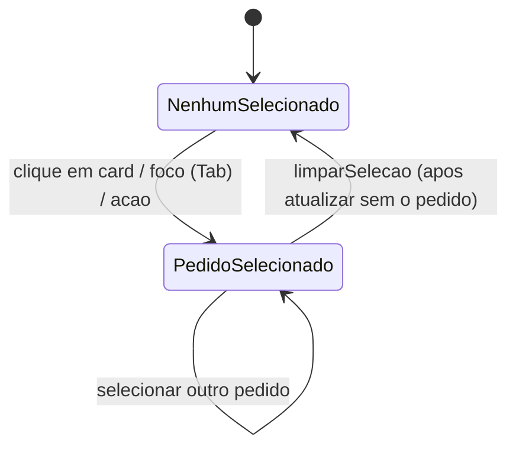
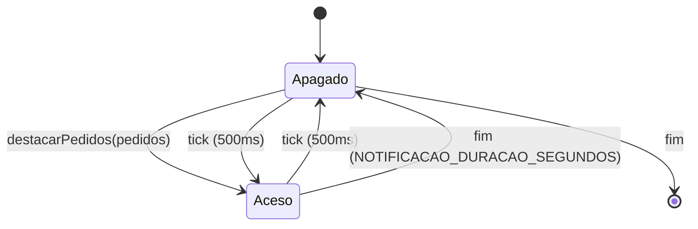
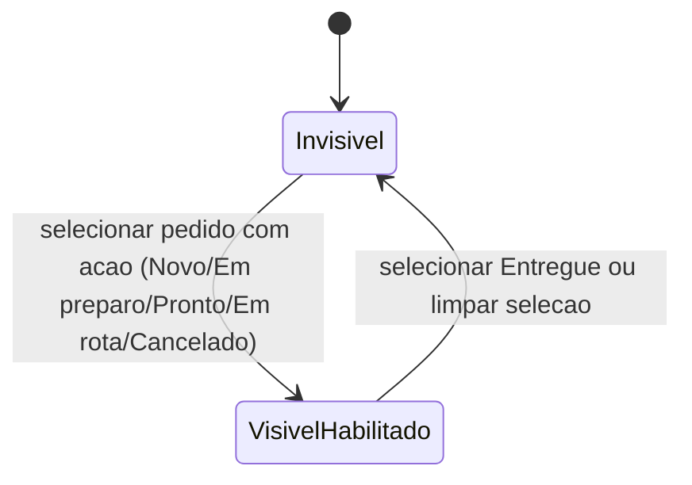
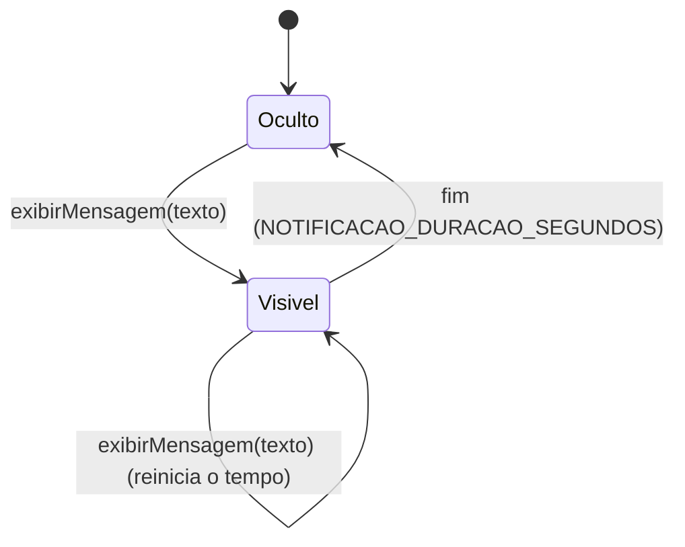

# Maquinas de estado (UML) por elemento

Diagramas de maquina de estados finita (UML) para cada elemento do sistema que
usa o padrao **State** ou que possui estados (mesmo sem usar o padrao hoje).
Fonte: codigo implementado. Diagramas em Mermaid `stateDiagram-v2`.

Documentos relacionados: requisitos em [`spec.md`](./spec.md); padroes de projeto
e diagramas de classe UML, com as referencias ABNT, em [`design.md`](./design.md);
cenarios nos `us2*.feature` desta pasta.

Indice:
1. `Pedido` (usa GoF State)
2. Status derivado do card (`Pedido` + pagamento)
3. `TravaInstanciaUnicaArquivo` (estados implicitos; nao usa State)
4. `PainelPedidoPresenter` - estados de interface (nao usa State)
5. Onde o State caberia (possibilidades nao adotadas)

---

## 1. `Pedido` (GoF State)

Elemento: `model.PedidoAbstract` (contexto) + `model.PedidoState` (abstrata,
package-private) e concretos `PedidoNovoState`, `PedidoEmPreparoState`,
`PedidoProntoParaEntregaState`, `PedidoEmRotaDeEntregaState`,
`PedidoEntregueState`, `PedidoCanceladoState`.

O State mora no pacote `model`, junto do contexto, e nao e publico: o contrato
publico (`PedidoAbstract`) nao expoe tipo interno e a dependencia aponta para o
estavel. A transicao e `pedido.setEstado(new PedidoProximoState(pedido))`, com
`setEstado` package-private.

**Descricao dos estados**

| Estado | Classe | Operacoes permitidas | Observacao |
|---|---|---|---|
| Novo | `PedidoNovoState` | `registrarPagamento`, `cancelar` | Sem pagamento ainda. |
| Em preparo | `PedidoEmPreparoState` | `marcarProntoParaEntrega`, `cancelar` | Exige pagamento (construtor). |
| Pronto para entrega | `PedidoProntoParaEntregaState` | `sairParaEntrega`, `cancelar` | Exige pagamento. |
| Em rota de entrega | `PedidoEmRotaDeEntregaState` | `marcarEntregue`, `cancelar` | Exige pagamento. |
| Entregue | `PedidoEntregueState` | `cancelar` | Exige pagamento. |
| Cancelado | `PedidoCanceladoState` | (nenhuma) | Calcula o credito no construtor. |

**Transicoes (guardas e efeitos)**
- `Novo --registrarPagamento(forma)--> Em preparo`: aplica a forma e a data/hora
  do pagamento.
- `Em preparo --> Pronto para entrega --> Em rota de entrega --> Entregue`:
  avancos operacionais.
- Qualquer estado nao Cancelado `--cancelar--> Cancelado` (BR13); se houver
  pagamento, gera credito igual ao valor do pedido.
- Pre-condicao de entrada (no construtor do estado alvo): `Em preparo`,
  `Pronto para entrega`, `Em rota de entrega` e `Entregue` exigem
  `isPagamentoRegistrado()`; se falhar, lanca excecao e **a transicao nao
  ocorre**.
- Operacoes nao previstas para o estado lancam `RuntimeException` (default em
  `PedidoState`) e nao transitam.
- `setEstado(...)` (efeito de toda transicao): limpa `prioridade` e atualiza
  `dataHoraMudancaEstado`.

**Fora da maquina de estados**
- `copiarComoNovo()` so e permitido em `Cancelado` e cria um **novo**
  `PedidoAbstract` na situacao `Novo` (novo objeto, nao uma transicao do mesmo
  pedido).
- `prioridade` e uma **flag ortogonal** (nao e estado): marcada pelo SLA e
  limpa em `setEstado`.

---

## 2. Status derivado do card (`Pedido` + pagamento)

Nao e um estado proprio armazenado; e derivado de `PedidoAbstract` para o rotulo
do card (`ApresentacaoDoPedido.textoDoStatus`). Mapeamento:

| Condicao | Rotulo |
|---|---|
| `pedido.estaCancelado()` | "Pedido cancelado" |
| `pedido.isPagamentoRegistrado()` (e nao cancelado) | "Pagamento confirmado" |
| caso contrario | "Aguardando pagamento" |

Rotulo adicional ortogonal: "Prioridade" (vermelho) quando `pedido.isPrioridade()`
(SLA); removido ao mudar de estado.

---

## 3. `TravaInstanciaUnicaArquivo` (nao usa State)

Elemento: `internal.aplicacao.TravaInstanciaUnicaArquivo`, possuida por
`aplicacao.PainelPedidoFacade` (adquire ao iniciar, libera ao encerrar).

```mermaid
stateDiagram-v2
    [*] --> Livre
    Livre --> Travada : adquirir() [tryLock != null]
    Livre --> Livre : adquirir() [tryLock == null ou OverlappingFileLockException]
    Travada --> Travada : adquirir() [ja travada nesta instancia -> false]
    Travada --> Livre : liberar() [fecha o canal; o arquivo permanece]
    Livre --> [*]
```

- **Livre**: nenhum processo detem a trava; a abertura do painel e concedida.
- **Travada**: esta instancia detem a trava de arquivo; a abertura e recusada
  (`iniciar()` ou `iniciarEmbutido()` devolve `false`) e **nada** e aberto.
- `liberar()` fecha o canal - a trava cede - e **nao apaga o arquivo**: apaga-lo e
  o que quebraria a exclusao. Fechar e reabrir no mesmo processo volta a abrir
  porque a fachada nao guarda flag "ja aberto" em memoria: a trava e a fonte
  unica da verdade.
- Nao usa o padrao State (resultado de `tryLock`/`close`).

---

## 4. `PainelPedidoPresenter` - estados de interface (nao usa State)

Elemento: `internal.presenter.PainelPedidoPresenter`. Varios estados de interface
controlados por campos/Timers (nao pelo padrao State).

### 4.1 Selecao de pedido

### 4.2 Destaque piscante dos novos pedidos (`destaqueAceso`)

### 4.3 Botao "Executar acao" (visivel/habilitado)

### 4.4 Label de notificacao ("Novo Pedido #id" / "N novos pedidos")

- Nenhum desses usa o padrao State (campos booleanos/Timers). Sao estados de
  apresentacao coordenados pela Presenter.

---

## 5. Onde o State caberia (possibilidades nao adotadas)

Elementos com estado implicito hoje, e o que a adocao do State custaria em cada
um. A regra que sai daqui: **State serve a um eixo; eixo ortogonal ao ciclo de
vida pede flag ou tipo derivado, nao uma segunda hierarquia.**

### 5.1 Ciclo de vida do painel na fachada (Fechado -> Aberto)

- **Hoje:** `iniciar()` e `iniciarEmbutido()` devolvem `boolean` e `encerrar()`
  libera; o "estado" e a propria trava, que e a fonte unica da verdade.
- **Com State:** `PainelFechadoState`/`PainelAbertoState` responderiam a
  `iniciar`/`encerrar`, com a transicao guardada pela trava e mensagens proprias
  por estado.
- **Vale se:** surgirem mais situacoes (encerrando, aberto embutido, aberto com
  erro) ou se a fachada acumular condicionais sobre isso. **Hoje nao vale:** sao
  dois estados, ja representados pela trava; a hierarquia adicionaria classes sem
  remover branching nenhum.

### 5.2 Modo de interacao do presenter (NadaSelecionado -> PedidoSelecionado)

- **Hoje:** os 4 estados de interface da secao 4 sao campos (`destaqueAceso`,
  `identificadorPedidoSelecionado`, visibilidade do botao, label).
- **Com State:** `SemSelecaoState`/`ComPedidoSelecionadoState` decidiriam o que o
  botao faz e se o destaque esta aceso, com o presenter delegando em vez de
  ramificar.
- **Vale se:** a selecao ganhar mais modos (multipla, faixa por teclado,
  arrastar). **Hoje nao vale:** cada "estado" e um campo e tres atribuicoes, e a
  apresentacao por estado ja foi extraida para `ApresentacaoDoPedido`.

### 5.3 Prioridade por SLA no pedido (Normal -> Priorizado)

- **Hoje:** flag booleana `prioridade` no modelo, marcada pelo monitor de SLA e
  limpa em `setEstado`.
- **Com State:** seria um **segundo** eixo de estado no mesmo objeto, convivendo
  com o State do ciclo de vida.
- **Nao vale:** State modela **um** eixo de comportamento variavel. Para um eixo
  ortogonal, a flag (ou um tipo `Prioridade`) e mais honesta e mais barata que
  uma segunda hierarquia - e a hierarquia dupla e justamente o tipo de confusao
  que o padrao evita quando bem aplicado.

### 5.4 Situacao do pagamento (Aguardando -> Confirmado)

- **Hoje:** derivado - `isPagamentoRegistrado()` mais o rotulo da secao 2.
- **Com State:** `AguardandoPagamentoState`/`PagamentoConfirmadoState`.
- **Nao vale:** e o **mesmo eixo** do ciclo de vida - "Em preparo" so ocorre com
  pagamento registrado. Um State aqui duplicaria a maquina da secao 1 sem
  acrescentar transicao alguma; o derivado e suficiente e nao pode divergir.
