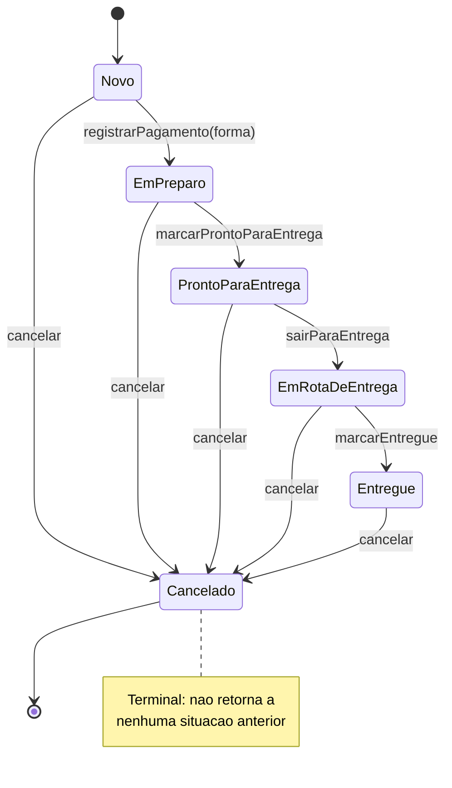
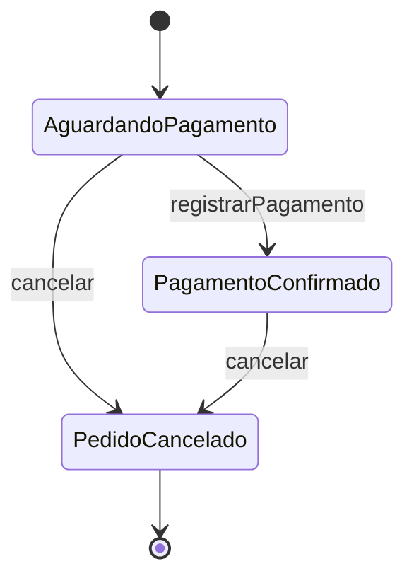
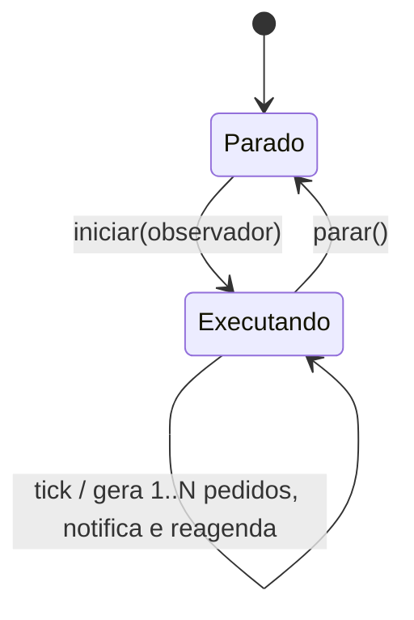
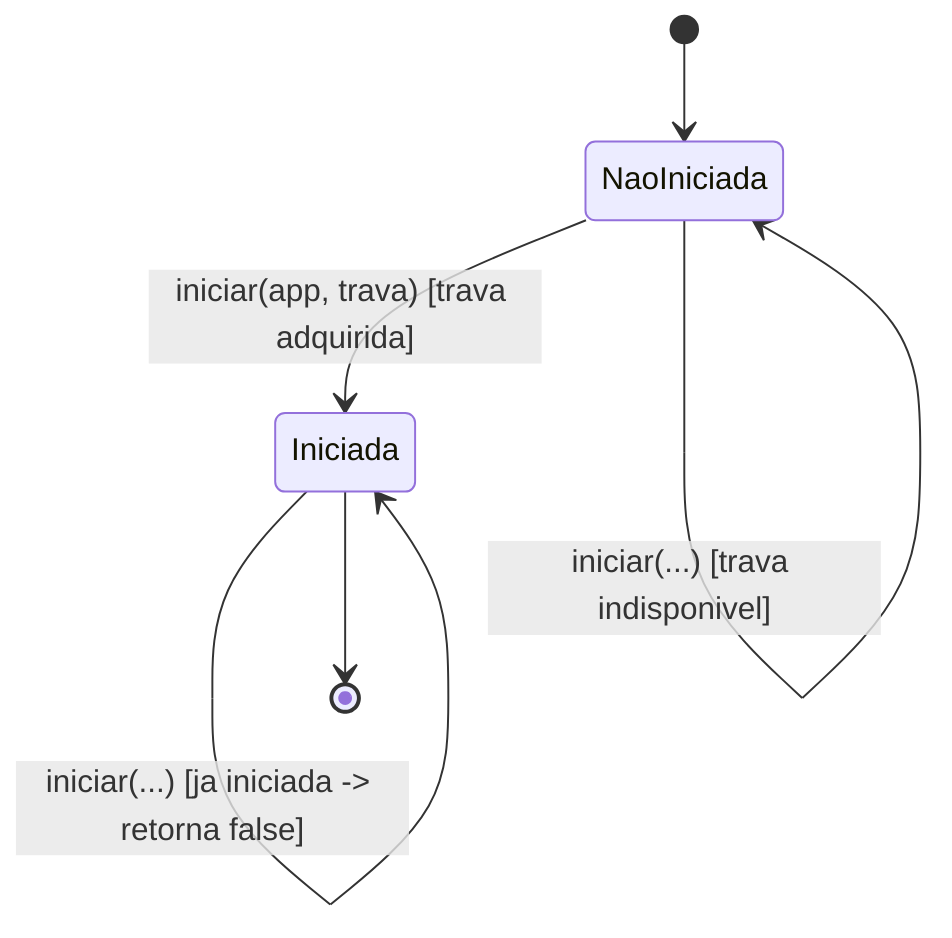
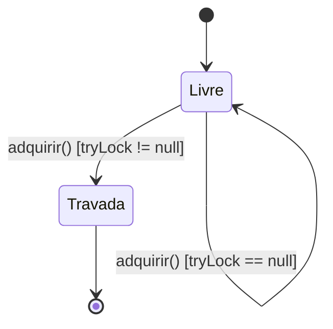
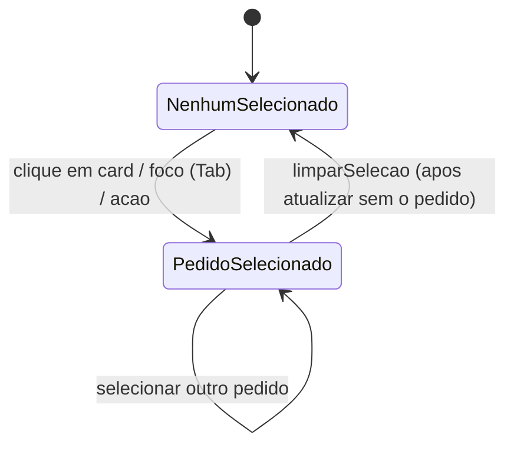
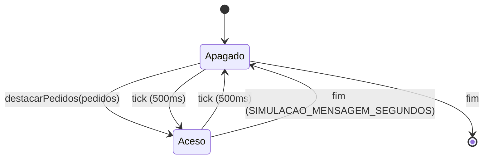
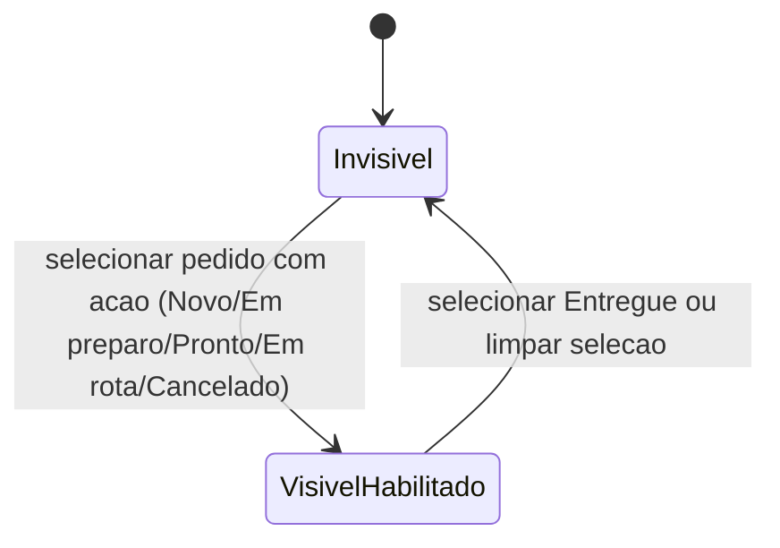
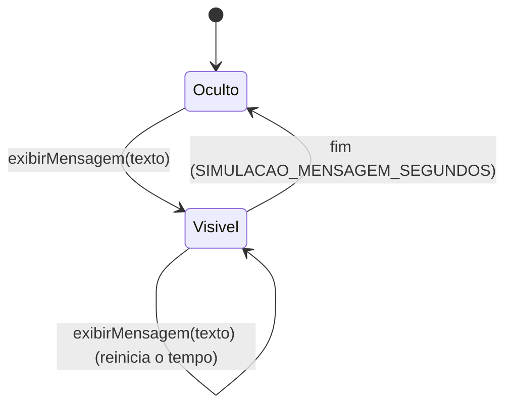

# Maquinas de estado (UML) por elemento

Diagramas de maquina de estados finita (UML) para cada elemento do sistema que
usa o padrao **State** ou que possui estados (mesmo sem usar o padrao hoje).
Fonte: codigo implementado (78 classes). Diagramas em Mermaid `stateDiagram-v2`.

Indice:
1. `Pedido` (usa GoF State)
2. Status derivado do card (`Pedido` + pagamento)
3. `SimuladorNovoPedido` (estados implicitos; nao usa State)
4. `InstanciaUnicaAplicacao` (estados implicitos; nao usa State)
5. `TravaInstanciaUnicaArquivo` (estados implicitos; nao usa State)
6. `PainelPedidoPresenter` - estados de interface (selecao, destaque, botao, label)

---

## 1. `Pedido` (GoF State)

Elemento: `model.Pedido` (contexto) + `state.PedidoState` e concretos
`PedidoNovoState`, `PedidoEmPreparoState`, `PedidoProntoParaEntregaState`,
`PedidoEmRotaDeEntregaState`, `PedidoEntregueState`, `PedidoCanceladoState`.

**Descricao dos estados**

| Estado | Classe | Operacoes permitidas | Observacao |
|---|---|---|---|
| Novo | `PedidoNovoState` | `registrarPagamento`, `cancelar` | Sem pagamento ainda. |
| Em preparo | `PedidoEmPreparoState` | `marcarProntoParaEntrega`, `cancelar` | Exige pagamento (construtor). |
| Pronto para entrega | `PedidoProntoParaEntregaState` | `sairParaEntrega`, `cancelar` | Exige pagamento. |
| Em rota de entrega | `PedidoEmRotaDeEntregaState` | `marcarEntregue`, `cancelar` | Exige pagamento. |
| Entregue | `PedidoEntregueState` | `cancelar` | Exige pagamento. |
| Cancelado | `PedidoCanceladoState` | (nenhuma) | Calcula o credito no construtor. |

**Transicoes (guardas e efeitos)**
- `Novo --registrarPagamento(forma)--> Em preparo`: aplica a forma e a data/hora
  do pagamento.
- `Em preparo --> Pronto para entrega --> Em rota de entrega --> Entregue`:
  avancos operacionais.
- Qualquer estado nao Cancelado `--cancelar--> Cancelado` (BR13); se houver
  pagamento, gera credito igual ao valor do pedido.
- Pre-condicao de entrada (no construtor do estado alvo): `Em preparo`,
  `Pronto para entrega`, `Em rota de entrega` e `Entregue` exigem
  `isPagamentoRegistrado()`; se falhar, lanca excecao e **a transicao nao
  ocorre**.
- Operacoes nao previstas para o estado lancam `RuntimeException` (default em
  `PedidoState`) e nao transitam.
- `setEstado(...)` (efeito de toda transicao): limpa `prioridade` e atualiza
  `dataHoraMudancaEstado`.

**Fora da maquina de estados**
- `copiarComoNovo()` so e permitido em `Cancelado` e cria um **novo** `Pedido`
  na situacao `Novo` (novo objeto, nao uma transicao do mesmo pedido).
- `prioridade` e uma **flag ortogonal** (nao e estado): marcada pelo SLA e
  limpa em `setEstado`.

---

## 2. Status derivado do card (`Pedido` + pagamento)

Nao e um estado proprio armazenado; e derivado de `Pedido` para o rotulo do card
(`PainelPedidoPresenter.criarRotuloStatus`). Mapeamento:

| Condicao | Rotulo |
|---|---|
| `pedido.estaCancelado()` | "Pedido cancelado" |
| `pedido.isPagamentoRegistrado()` (e nao cancelado) | "Pagamento confirmado" |
| caso contrario | "Aguardando pagamento" |

Rotulo adicional ortogonal: "Prioridade" (vermelho) quando `pedido.isPrioridade()`
(SLA); removido ao mudar de estado.

---

## 3. `SimuladorNovoPedido` (nao usa State)

Elemento: `simulacao.SimuladorNovoPedido` (usa `javax.swing.Timer`). Estados
implicitos controlados por `iniciar(...)`/`parar()`.

- **Parado**: sem Timer ativo.
- **Executando**: Timer agendado; a cada disparo cria de 1 a
  `SIMULACAO_PEDIDOS_POR_CICLO` pedidos e notifica o `NovoPedidoObserver`.
- Nao usa o padrao State (apenas Timer + observador); candidato a refatoracao se
  surgirem mais estados (ex.: pausado, erro).

---

## 4. `InstanciaUnicaAplicacao` (nao usa State)

Elemento: `aplicacao.InstanciaUnicaAplicacao` (Singleton thread-safe com flag
`iniciada` e travamento por `synchronized`).

- **NaoIniciada**: ainda nao executou a aplicacao.
- **Iniciada**: aplicacao executada uma vez; novas tentativas retornam `false`.
- Nao usa o padrao State (flag booleana); poderia virar State se houvesse mais
  situacoes (ex.: encerrando).

---

## 5. `TravaInstanciaUnicaArquivo` (nao usa State)

Elemento: `aplicacao.TravaInstanciaUnicaArquivo` (implementa
`ITravaInstanciaUnica` via `FileLock`).

- **Livre**: nenhum processo detem a trava.
- **Travada**: esta instancia detem a trava de arquivo (impede outra instancia).
- Nao usa o padrao State (resultado de `tryLock`).

---

## 6. `PainelPedidoPresenter` - estados de interface (nao usa State)

Elemento: `presenter.PainelPedidoPresenter`. Varios estados de interface
controlados por campos/Timers (nao pelo padrao State).

### 6.1 Selecao de pedido

### 6.2 Destaque piscante dos novos pedidos (`destaqueAceso`)

### 6.3 Botao "Executar acao" (visivel/habilitado)

### 6.4 Label de notificacao ("Novo Pedido #id" / "N novos pedidos")

- Nenhum desses usa o padrao State (campos booleanos/Timers). Sao estados de
  apresentacao coordenados pela Presenter.
